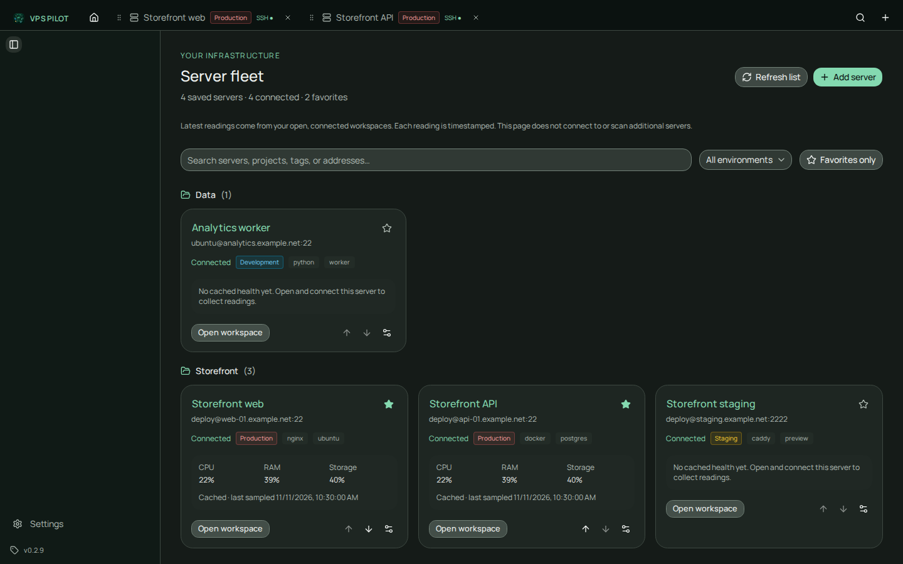
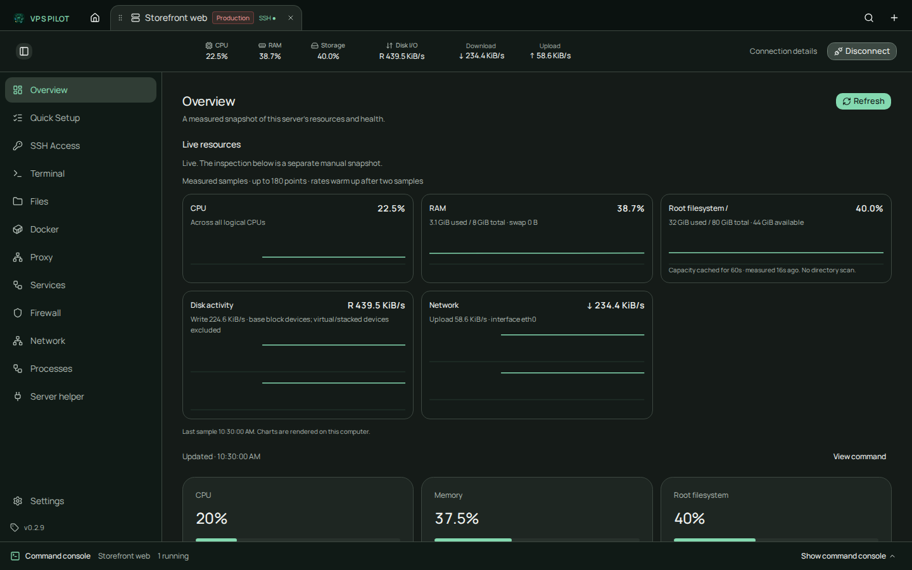
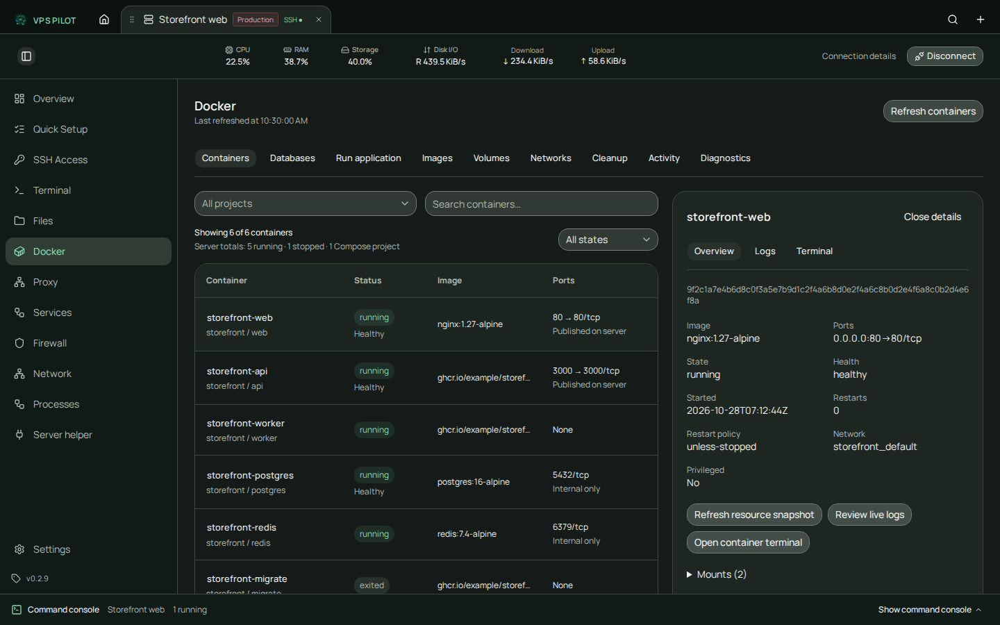
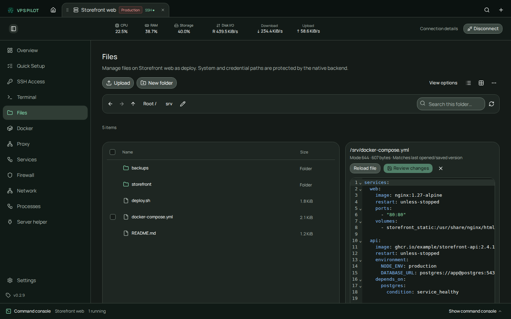
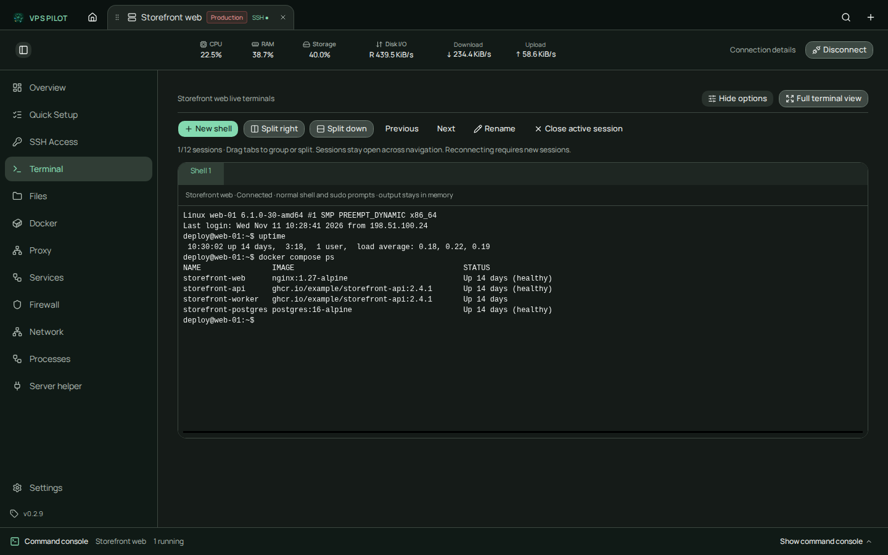

# VPS Pilot

A desktop workspace for Linux VPS servers. VPS Pilot combines verified SSH
connections, split terminals, live health, SFTP files, Docker management and a
six-step provisioning wizard in one Tauri 2 app. Each server keeps its own tabs,
sessions, charts and command activity, and the exact command behind every app
action stays visible.



## Download

Installers are published with every complete GitHub Release. These links always
resolve to the latest published version; the page does not call the GitHub API.

| Platform | Downloads |
| --- | --- |
| Linux x64 | [DEB](https://github.com/khalids01/vps-pilot/releases/latest/download/VPS-Pilot-linux-x64.deb) · [AppImage](https://github.com/khalids01/vps-pilot/releases/latest/download/VPS-Pilot-linux-x64.AppImage) · [RPM](https://github.com/khalids01/vps-pilot/releases/latest/download/VPS-Pilot-linux-x64.rpm) |
| Windows x64 | [Installer](https://github.com/khalids01/vps-pilot/releases/latest/download/VPS-Pilot-windows-x64-setup.exe) · [MSI](https://github.com/khalids01/vps-pilot/releases/latest/download/VPS-Pilot-windows-x64.msi) |
| macOS | [Apple Silicon](https://github.com/khalids01/vps-pilot/releases/latest/download/VPS-Pilot-macos-apple-silicon.dmg) · [Intel](https://github.com/khalids01/vps-pilot/releases/latest/download/VPS-Pilot-macos-intel.dmg) |

All releases include `SHA256SUMS.txt` and immutable versioned assets.
Windows installers are unsigned. macOS builds use ad-hoc signing and are not
notarized.

## What it does

- **Multiple servers, isolated workspaces.** Fleet home organizes saved servers
  by project, tag, environment and favorite. Each open VPS tab owns its own
  terminal sessions, monitoring history, file browser and command console.
- **Verified SSH access.** Compare host fingerprints before authentication, use
  passwords, private keys, encrypted keys, a Unix agent or SSH config discovery,
  and keep every connection independent. Credentials remain transient.
- **Split remote terminals.** Open up to 12 SSH PTYs per VPS, split right or down,
  group tabs, rename and maximize. Sessions survive navigation; restored layouts
  never reconnect or replay commands automatically.
- **Live health over SSH.** One lightweight Python sampler reads Linux `/proc`
  and `/sys/block` counters for CPU, memory, root filesystem, disk I/O and
  network at 1, 2 or 5 seconds. There is no daemon, listener or package install.
- **Read-only Linux inspections.** Overview, software, Docker, proxy, services,
  storage, firewall, network and processes produce timestamped tables and cards.
  Missing tools and permissions stay visible as partial results.
- **SFTP files and reviewed edits.** Browse, filter, select, copy, move, rename,
  upload, download and create folders. Delete moves to private server trash with
  session restore. Reviewed saves keep a protected backup and reject stale files.
- **Docker in the same window.** Inspect containers, Compose projects, details,
  one-shot stats, bounded live logs and container shells. Reviewed lifecycle,
  deployment, resource and cleanup actions protect volumes, mounted data and
  infrastructure workloads.
- **Six-step Quick Setup.** Connection overview, administrator and SSH key,
  SSH/firewall migration, application stack, developer tools and runtimes. Each
  step applies its own changes with explicit command approvals and verification.

## Screenshots

`bun run update-readme` captures these views from the real React app with a
strictly mocked desktop bridge and synthetic local data. It writes the PNGs to
`docs/screenshots/` and copies the same files to `website/assets/screenshots/`.

| Live overview | Docker inventory |
| --- | --- |
|  |  |

| Remote files and editor | Terminal workspace |
| --- | --- |
|  |  |

## Current limits

VPS Pilot is an early preview. The important boundaries are explicit:

- Generic app-triggered systemd, proxy and firewall mutations remain disabled in
  Rust in normal builds. Reviewed SFTP writes, Docker management and the narrow
  `setup-provisioning` capability are separate, enabled policies.
- Quick Setup accepts Debian 12/13 and Ubuntu 22.04/24.04/26.04/26.10 on
  x86_64/arm64. Full provisioning and SSH/UFW recovery were validated on
  Debian 12 arm64; every other accepted combination still needs release
  validation.
- Live monitoring requires Linux `/proc`, `/sys/block` and Python 3 for the SSH
  user. Other Linux distributions are not certified by the current fixture.
- SFTP text editing is UTF-8 and limited to 1 MiB per file, 32 MiB per transfer
  and 1,000 directory entries. Existing-file replacement requires the OpenSSH
  atomic-rename extension.
- Docker lifecycle and cleanup require Python 3 and access to the host's local
  Unix-socket Docker engine. Image builds and volume deletion are not enabled.
- Native Tauri/WebKit interaction, sustained terminal throughput and the full
  supported-distribution matrix still need release QA.
- Passwords, private-key contents, terminal output and per-second metrics are
  never stored in SQLite. Saved tabs do not reconnect automatically.

See [supported systems and validation boundaries](agents/supported-systems.md)
for the full matrix.

## Development

Prerequisites: Bun, Rust, and Tauri 2 platform dependencies (WebKitGTK 4.1 and
build tools on Linux).

```sh
bun install --frozen-lockfile
bun run tauri dev          # desktop development
bun run dev                # browser preview at http://localhost:1430
bun run check              # Biome formatting and lint
bun run build              # frontend production build and typecheck
bun test                   # focused unit tests
bun run test:e2e           # browser tests with a mocked desktop bridge
bun run update-readme      # regenerate docs and website screenshots
cargo check --manifest-path src-tauri/Cargo.toml --locked
cargo test --manifest-path src-tauri/Cargo.toml --lib
bun run tauri build        # desktop packages
```

Run either desktop development or browser preview at a time; both use port 1430.
The browser preview cannot make real SSH connections because it has no native
bridge. Automated browser scenarios supply synthetic fixtures.

## More documentation

- [Application guide](docs/app-guide.md) — detailed workflows, safety behavior
  and earlier increment notes.
- [Quick Setup product direction](agents/quick-setup.md) and
  [product goal](agents/goal.md).
- [Implementation plan](agents/plan.md), [monitoring validation](agents/monitoring-validation.md)
  and [disposable test fixtures](tests/fixtures/README.md).
- [Self-updater setup](docs/self-updater.md) and [release notes](release-notes.md).

## Landing page and releases

The static product site lives in `website/` and is deployed to GitHub Pages from
`main` by `.github/workflows/pages.yml`. Preview it locally with:

```sh
python3 -m http.server 4174 --directory website
```

Set repository **Settings → Pages → Source** to **GitHub Actions**. The live
domain is <https://vpspilot.skycanvasstudio.com/>. The site uses permanent
latest-release installer URLs and does not fetch download metadata in the
visitor's browser.

`.github/workflows/screenshots.yml` refreshes the product screenshots on relevant
`main` changes and on manual dispatch, committing only generated PNGs when they
change and deploying the updated website. It requires permission to push to
`main`; branch rules that prevent bot commits will require a local capture and
normal pull request instead. Install Chromium once with
`bunx playwright install --with-deps chromium` before the first local capture.
`.github/workflows/release.yml` builds all seven installer formats and publishes
a release only after every platform artifact and checksum succeeds.
